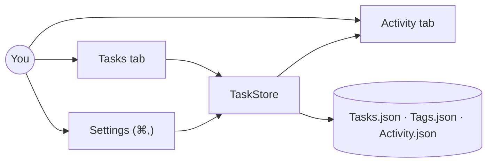

# Super Simple Todo

A very simple Mac checklist: one list, priorities shown by color, optional #tags, and a chart of what you got done.

 

  
  

Type `Run 5k #fitness !!` → a Medium-priority task tagged Fitness. Click a tag to filter, double-click to rename, ⌘Z to undo.

| Circle | Priority | Type at the end |
|---|---|---|
| 🔴 Red | High | `!!!` |
| 🟠 Orange | Medium | `!!` |
| 🔵 Blue | Low | `!` |
| ⚪ Grey | None | — |

**Docs**
- [How to set up, run and use it](docs/INSTRUCTIONS.md)
- [System design](docs/SYSTEM-DESIGN.md)
- [What's where](docs/FILE-STRUCTURE.md)
