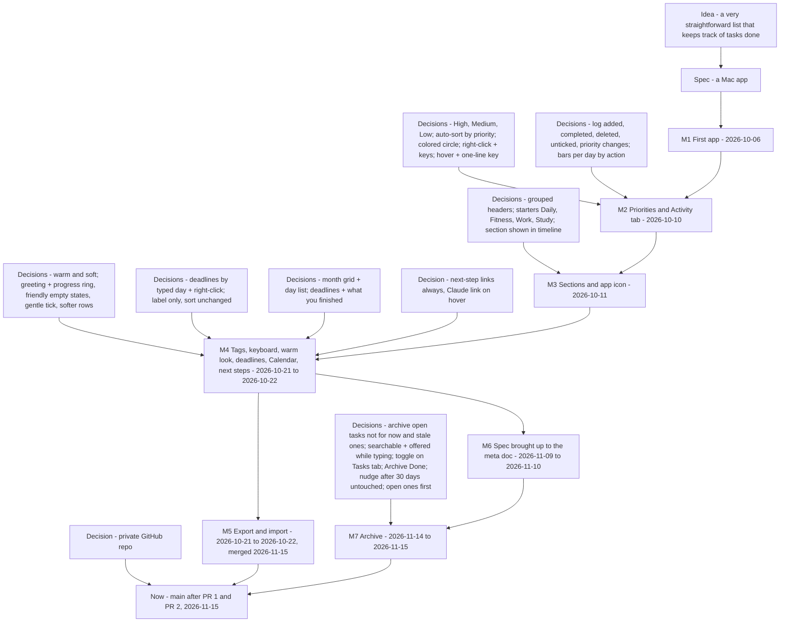
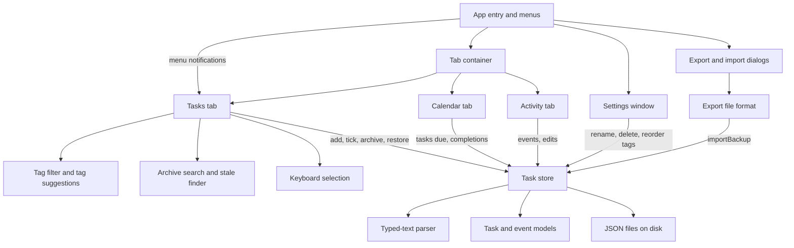
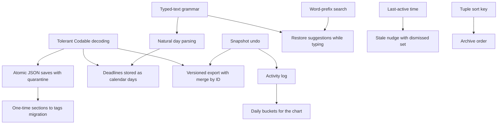

<!-- ProjectForge explainer at d1d871b -->
# How super_simple_todo was built

Super Simple Todo is a small Mac app for one person who wants a plain list of tasks they can tick off. It is written in Swift with SwiftUI, Apple's framework for building app screens from code. The one idea that makes it work: every change goes through a single store, `TaskStore`, which saves a snapshot for undo, logs what happened and writes three JSON files after each change (`Super Simple Todo/TaskStore.swift`).

## Build history

- **M1, 2026-10-06:** The first Mac checklist app, with settings, tests and a system design doc.
- **M2, 2026-10-10:** Priorities shown as a colored circle with a one-line color key, and an Activity tab with a daily bar chart and a timeline. The author chose which actions to log; the log can only record from that point on.
- **M3, 2026-10-11:** Sections: `#tag` filing, collapsible grouped headers, and section management in Settings. The decisions were written into the spec, an app icon drawn by `tools/MakeIcon.swift` was added, and sections were made always visible with a hint when empty.
- **M4, 2026-10-21 to 2026-10-22:** Sections were replaced by tags on a single list. Saved sections data is migrated to tags once on load, with an earlier backup kept so the migration does not repeat. The reason for the switch is not recorded. This milestone also added a README, undo, rename, a tag filter, keyboard selection, editable history, and install and screenshot scripts. It added the warm look, deadlines and a Calendar tab, plus next-step links under tasks that open in the Claude desktop app. It added full keyboard control, VoiceOver descriptions (VoiceOver is the Mac's screen reader) and a shortcuts list. Tag suggestions appear while typing `#`, below the add field.
- **M5, 2026-10-21 to 2026-11-15:** Export and import of everything as one versioned JSON file, plus docs. It was committed on 2026-10-21, reverted on 2026-10-22 (no reason recorded), redone on the `export-import` branch, and merged as PR #1 on 2026-11-15.
- **M6, 2026-11-09 to 2026-11-10:** The spec was brought up to date with the author's meta doc (a shared document of guidance across projects), with the shared shortcuts added, and a line was added on fitting how people naturally interact with the world.
- **M7, 2026-11-14 to 2026-11-15:** An archive for open tasks that aren't for now and tasks that went stale. You can bring tasks back from a search or while typing, and Archive Done replaces the old Clear Done. It was merged as PR #2.

## Code map

The logic that has no screen, such as tag filtering, archive search and keyboard moves, sits in its own types so tests can call it directly. `TagFilter.swift:3` and `Archive.swift:3-4` say this in their comments.

| Part | File | What it does |
|---|---|---|
| App entry and menus | `Super Simple Todo/SuperSimpleTodoApp.swift` | Creates the one `TaskStore`, the main window, Settings, and menu commands with shortcuts. |
| Tab container | `Super Simple Todo/ContentView.swift` (`ContentView`) | Holds the Tasks, Calendar and Activity tabs and hands the window's undo manager to the store. |
| Tasks tab | `Super Simple Todo/ContentView.swift` (`TasksView`, `TaskRow`, `AddTaskField`), `Super Simple Todo/ArchiveViews.swift` | The list, the add field, the archive screen, the stale-task nudge and right-click menus. |
| Calendar tab | `Super Simple Todo/CalendarView.swift` | A month grid with priority dots and a done mark, plus a list for the chosen day. |
| Activity tab | `Super Simple Todo/ActivityView.swift` | A Swift Charts bar chart per day by action, a summary line and an editable timeline. |
| Settings window | `Super Simple Todo/SettingsView.swift` | Hide done tasks, manage tags, clear history and list the shortcuts. |
| Export and import dialogs | `Super Simple Todo/BackupPanels.swift` | Save and open panels, plus the Merge or Replace question and the result alert. |
| Export file format | `Super Simple Todo/Backup.swift` | The versioned export file: encoding, checked decoding and readable errors. |
| Task store | `Super Simple Todo/TaskStore.swift` | Holds all state. Every change, its undo step, its log entry and the save go through here. |
| Typed-text parser | `Super Simple Todo/TaskStore.swift` (`parse`, `parseDay`, `webAddress`) | Turns typed text into a title, priority, tags, deadline and link. |
| Task and event models | `Super Simple Todo/TaskItem.swift`, `Super Simple Todo/ActivityEvent.swift` | The saved shapes of a task and a logged action, plus the day-count helpers. |
| Tag filter and tag suggestions | `Super Simple Todo/TagFilter.swift` | Narrows the list to one tag and ranks tag suggestions while you type `#`. |
| Archive search and stale finder | `Super Simple Todo/Archive.swift` | Word-prefix search of the archive, restore suggestions and the 30-day untouched rule. |
| Keyboard selection | `Super Simple Todo/KeyboardControl.swift` | Up and down arrow moves, keeping a selection when the list changes, and the shortcut list. |
| JSON files on disk | `~/Library/Application Support/Super Simple Todo/` (path built in `TaskStore.defaultFileURL`) | `Tasks.json`, `Activity.json` and `Tags.json`. |

## Concepts

**Snapshot undo** — Before each change, `change(_:_:)` copies the whole state (tasks, events, tags) into a `Snapshot`. Undo puts that copy back. While it does, it registers the opposite step with the current state, so undo and redo alternate. The data is small, so copying all of it is simpler than writing a reverse step for every kind of edit. Every edit, including imports and tag renames, becomes one undo step for free. Lives in `Super Simple Todo/TaskStore.swift:457-483`.

**Activity log** — Each tick, untick, add, delete and priority change appends an `ActivityEvent` with the task's title and tags at that moment. Because it stores copies, the history survives deleting or renaming the task. On first launch with no log, the app rebuilds "added" events from each task's `createdAt`, since that was the only history saved before. Lives in `Super Simple Todo/ActivityEvent.swift` and `TaskStore.log` / `TaskStore.load` in `Super Simple Todo/TaskStore.swift`. Archiving is deliberately not logged (`TaskStore.swift:204`).

**Tolerant Codable decoding** — Codable is Swift's system for turning types into JSON and back. `TaskItem` and `ActivityEvent` write their own decoders. These use `decodeIfPresent` with a default, so files saved before a field existed (priority, tags, archivedAt, touchedAt) still load. Lives in `Super Simple Todo/TaskItem.swift:61-74` and `Super Simple Todo/ActivityEvent.swift:54-62`.

**Deadlines stored as calendar days** — A deadline is saved as the text `yyyy-MM-dd` in the user's time zone, not as an instant in time. An instant would shift to the previous or next day if the Mac's time zone changed, and a deadline is a day, not a moment. Lives in `TaskItem.dayFormatter`, `Super Simple Todo/TaskItem.swift:90-98`.

**Atomic JSON saves with quarantine** — After each change the store writes all three files with `.atomic`. An atomic write goes to a temporary file first, then swaps it in, so a crash never leaves half a file. If a file exists but won't decode, `read` renames it to `<name>.unreadable-<date>.json` before going on. Without this, the next save would overwrite the user's data with an empty list. Lives in `TaskStore.read` and `TaskStore.save`, `Super Simple Todo/TaskStore.swift:572-597`.

**One-time sections to tags migration** — The sections version saved a `"section"` key on each task and event, plus `Sections.json`. On load, `migrateSections` turns each section into a tag of the same name and keeps the order. It then renames `Sections.json` to `Sections.migrated.json`, so the next launch finds nothing to migrate. If an older backup is in the way, it adds a date to the name, so neither file is lost and the migration still doesn't repeat. Lives in `Super Simple Todo/TaskStore.swift:520-570`, tested with old-format fixture files in `Tests/Fixtures/SectionsVersion/`.

**Versioned export with merge by ID** — The export file has a `format` name and a `version` number. `Backup.decode` first reads the file as loose JSON and checks those two fields. Only then does it decode the full contents. This lets it give a clear reason for the failure ("not an export", "too new", "damaged"), not a raw parse error. It also refuses files where two tasks share an ID. A UUID is a random 128-bit ID given to every task and event. Merge uses it to skip anything already present, so importing the same file twice adds nothing. Lives in `Super Simple Todo/Backup.swift` and `TaskStore.importBackup`, `Super Simple Todo/TaskStore.swift:321-352`.

**Typed-text grammar** — The add field reads markers out of one line of text. A word made only of 1 to 3 `!` sets the priority; the count is the raw value. `#` followed by a letter adds a tag. `@` followed by a day sets the deadline. The first `http`, `https` or `www.` address becomes the link. Everything else is the title. If only markers were typed, the whole text becomes the title, so nothing typed is lost. The author chose this so tasks can be set up without leaving the keyboard. Lives in `TaskStore.parse` and `TaskStore.webAddress`, `Super Simple Todo/TaskStore.swift:360-403`. `#deep-work` becomes the tag "Deep work" through `tagName(fromTag:)`.

**Natural day parsing** — `parseDay` understands `today`, `tomorrow`, weekday names, `oct30`, `30oct`, `10/30` and `2026-10-30`. A name counts if you type at least three of its first letters. For weekdays, Swift numbers today's weekday \(w\) from 1 (Sunday) to 7. The typed weekday has index \(i\) from 0 (Sunday). The number of days ahead is

$$\text{ahead} = (i + 1 - w + 7) \bmod 7$$

So a weekday that is today gives 0 days ahead, and every other one is the next one coming. A month and day with no year that has already passed this year means next year. Impossible dates like `feb30` are refused by checking that the built date's day matches. Lives in `Super Simple Todo/TaskStore.swift:405-447`.

**Tuple sort key** — The list order compares tuples left to right. Open tasks come before done ones, then higher priority first, then older first. In code, task \(a\) comes before \(b\) when

$$(\text{done}_b,\ p_a,\ \text{offset}_b) > (\text{done}_a,\ p_b,\ \text{offset}_a)$$

Here done is 0 or 1, \(p\) is the priority from 0 (None) to 3 (High), and offset is the task's position in the order added. Swapping \(a\) and \(b\) in some slots flips those slots to descending order. This is the "auto-sort by priority" decision. Deadlines don't change the order, by the "label, sort unchanged" decision. Lives in `TaskStore.sortedTasks`, `Super Simple Todo/TaskStore.swift:52-62`. Tag suggestions use the same trick to rank by use count (`TagAutocomplete.ranked`, `Super Simple Todo/TagFilter.swift:48-53`).

**Archive order** — Archived tasks are shown open ones first, then finished ones, newest archived first within each. This follows the author's trade-off: Archive Done fills the archive with finished tasks, so the parked open ones must stay on top. Lives in `ArchiveSearch.sorted`, `Super Simple Todo/Archive.swift:27-32`.

**Word-prefix search** — Text is folded to lowercase without accents and split at anything that isn't a letter or digit. A task matches when every query word is the start of some word in its title or tags. So "ren pass" finds "Renew passport" and "fit" finds anything tagged Fitness. Lives in `ArchiveSearch.words` and `ArchiveSearch.matches`, `Super Simple Todo/Archive.swift:6-18`.

**Restore suggestions while typing** — While you type a new task, the add field drops marker words (`#`, `@`, `!`, links) and runs the prefix search over archived tasks. It needs at least 3 letters in total, so one or two keys don't flood the list. It shows up to 3 matches. Pressing Down then Return brings one back instead of adding a duplicate. This is the "offer it while I type" decision. Lives in `ArchiveSearch.restoreSuggestions`, `Super Simple Todo/Archive.swift:34-48`, used by `AddTaskField` in `Super Simple Todo/ContentView.swift`.

**Last-active time** — `touchedAt` is set on rename, priority, tag, deadline, link, tick and restore. A task's last-active time is

$$\text{lastActive} = \max(\text{createdAt},\ \text{touchedAt})$$

Restore sets `touchedAt` to now, so a task you just brought back isn't flagged as stale straight away. Lives in `Super Simple Todo/TaskItem.swift:33-55` and `TaskStore.restore`.

**Stale nudge with dismissed set** — A task is stale when it is open, not archived, and \(\text{lastActive} \le \text{now} - 30\text{ days}\) (`StaleTasks.find`). The nudge offers to archive them all at once; it never archives on its own. Choosing Not Now saves those task IDs to UserDefaults (the Mac's small per-app settings store) as one space-separated string. The nudge returns only when a stale task that is not in that set appears (`StaleTasks.shouldNudge`). Lives in `Super Simple Todo/Archive.swift:51-84`, with the nudge view in `Super Simple Todo/ArchiveViews.swift`.

**Daily buckets for the chart** — `dailyCounts` rounds each event down to the start of its day, keeps the last N days, and counts per day and kind. Days with no events produce no bars, and the chart's x-axis still covers the whole range. Swift Charts, Apple's charting framework, colors each kind by a fixed order of `ActivityEvent.Kind.allCases`. Lives in `Super Simple Todo/ActivityEvent.swift:82-99` and `Super Simple Todo/ActivityView.swift:68-86`.

## One input, start to finish

Input: on the Tasks tab you type `Renew passport #errands !! @fri https://travel.state.gov` and press Return.

1. **Typing.** `AddTaskField` in `Super Simple Todo/ContentView.swift` binds the text. After `Renew pas`, `restoreMatches` calls `ArchiveSearch.restoreSuggestions` (`Archive.swift`) and lists any archived task whose words start with "renew" and "pas". While you type `#err`, `TagAutocomplete.activeQuery` (`TagFilter.swift`) finds the `#word` in progress. `TagAutocomplete.suggestions` then lists matching tags, most used first, and tag suggestions hide the restore list.
2. **Submit.** Return with nothing picked runs `onSubmit`. In `TasksView.listScreen` (`ContentView.swift`) this calls `store.add(newTitle)` and clears the field.
3. **Flatten and parse.** `TaskStore.add` (`TaskStore.swift`) calls `flatten`, which joins any newlines into spaces. Then `parse` splits the text at spaces:
   - `https://travel.state.gov` passes `webAddress(_, requireMarker: true)` and becomes the link.
   - `!!` is two `!`, so the priority is `Priority(rawValue: 2)`, which is Medium.
   - `#errands` adds "errands" to the tag list.
   - `@fri` goes to `parseDay("fri")`. "fri" is the start of "friday", index 5, and the formula above gives the next Friday at the start of the day.
   - "Renew passport" is left as the title.
4. **Change.** `add` runs inside `change("Add Task")`, which first takes a `Snapshot`. `tagName(fromTag: "errands")` gives "Errands". `ensureTag` returns the existing tag if one matches without regard to case, or appends it to `tags`. A `TaskItem` is built (`TaskItem.swift`) with a new UUID and `createdAt` set to now. It is appended, and `log(.added, task)` appends an `ActivityEvent`.
5. **Undo and save.** `registerUndo` records the snapshot under the name "Add Task", so ⌘Z removes the task, the event and any new tag together. `save` writes `Tasks.json`, `Activity.json` and `Tags.json` atomically. The deadline goes out as `"yyyy-MM-dd"` through `TaskItem.encode`.
6. **Redraw.** `tasks`, `events` and `tags` are `@Published`, so SwiftUI redraws. `TasksView.visibleTasks` runs `TagFilter.apply` over `TaskStore.sortedTasks`. The new task sits after any open High tasks and after older open Medium ones. `TaskRow` shows an orange circle (`Priority.color`), the link line "Open travel.state.gov" (`NextStep.linkLabel`), and a `DeadlineLabel` such as "Fri", or "Today" or "Tomorrow" when that's closer. It also shows an "Errands" chip. `GreetingHeader` adds one to the total.
7. **Other tabs.** On Friday's cell, `CalendarView` gets the task from `TaskStore.tasks(dueOn:)` and shows an orange dot (`MonthGrid` in `CalendarView.swift`). `ActivityView` calls `dailyCounts` and today's "Added" bar grows by one (`ActivityView.swift`, `ActivityEvent.swift`).

## Where this came from

Written from the spec, the author's decisions, the git history and the code as of commit d1d871b, the latest on main.
