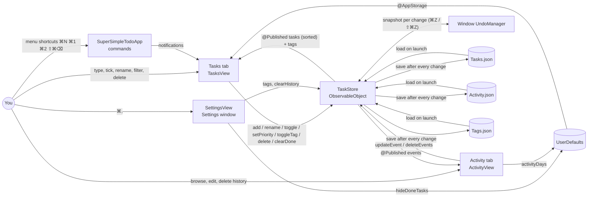

# Super Simple Todo — System Design

A single-window Mac checklist: one list, sorted by priority, with optional tags on each task (Daily, Fitness, Work, Study, plus any you create). You add tasks, tick them off, and clear the finished ones. An Activity tab charts what you've done over time.

## Architecture



## Components

| Component | File | Job |
|---|---|---|
| `SuperSimpleTodoApp` | `Super Simple Todo/SuperSimpleTodoApp.swift` | App entry point. Owns the one `TaskStore`, declares the main window, the Settings scene (⌘,) and the menu commands: File ▸ New Task (⌘N), View ▸ Tasks/Activity (⌘1/⌘2), Tasks ▸ Clear Done (⇧⌘⌫). The commands reach the views through two notifications. |
| `ContentView` | `Super Simple Todo/ContentView.swift` | The "Tasks \| Activity" tab switcher. It hands the window's `UndoManager` to the store. |
| `TasksView`, `TaskRow`, `TagChips`, `PriorityKey` | `Super Simple Todo/ContentView.swift` | The list: input field, a one-line color key, an optional "Showing [tag] ×" filter bar, and one list of selectable rows (colored tick circle, title or rename field, clickable tag labels). Keys: ⌫ deletes, Space ticks, Return renames, ↑↓ move. Right-click works on one task (Rename, Priority ▸, Tags ▸, Delete) or several (Tick or Untick, Delete). Double-click renames. Footer: "N of M done", Clear Done, Settings gear. |
| `ActivityView`, `EventRow`, `EventEditor`, `ActivityLegend` | `Super Simple Todo/ActivityView.swift` | A "Completed today · this week" line, a stacked bar chart of actions per day (7, 14 or 30 days), a legend, a hover tooltip per day, and a selectable timeline of every action, newest first, under plain day-header rows. ⌫ deletes selected entries; right-click or double-click opens `EventEditor` (task title, action, new priority, date and time, tags). |
| `SettingsView` | `Super Simple Todo/SettingsView.swift` | All preferences in one place: **Hide done tasks**, the **Tags** list (add, rename, delete, drag to reorder) and **History** (entry count, Clear History… with a confirmation). |
| `TaskStore` | `Super Simple Todo/TaskStore.swift` | The only place tasks, tags and history change. Every change runs through `change(_:_:)`, which snapshots the state, applies the change, registers an undo step and saves. It also parses `#tag` and `!` markers, sorts and filters, and records one event per action. |
| `TaskItem`, `Priority` | `Super Simple Todo/TaskItem.swift` | One task (id, title, done flag, priority, tags, created date) and the four priority levels. Reads the older one-`section` format as a single tag. |
| App icon | `Super Simple Todo/Assets.xcassets/AppIcon.appiconset`, drawn by `tools/MakeIcon.swift` | A white checklist tile with a ticked red task, then orange and blue ones, echoing the priority colors. The script draws the 1024 px master with Core Graphics; the 16–512 pt sizes are scaled from it with `sips`. |
| `ActivityEvent`, `dailyCounts`, `completedCounts` | `Super Simple Todo/ActivityEvent.swift` | One logged action (date, kind, task title, optional detail, tags at the time; all editable except the id), the per-day counts the chart draws, and the today and this-week completion counts. |
| Scripts | `tools/install.sh`, `tools/screenshots.sh` | `install.sh` builds a Release copy and puts it in /Applications. `screenshots.sh` retakes the README images from a separate test copy (its own app ID) running on generated sample data. |

## Tags

- **Starting tags:** Daily, Fitness, Work, Study, offered in the right-click menu. They're created the first time the app runs without a `Tags.json`. If a `Sections.json` from the earlier sections version exists, its names are used instead.
- **Tagging while typing:** add one or more `#name` words anywhere, e.g. `Run 5k #fitness #daily !!`. A tag matches an existing one ignoring case. An unknown tag is created on the spot: `#deep-work` becomes "Deep work". A tag must start with a letter, so "#1" and "C#" stay part of the title.
- **Tagging later:** right-click ▸ Tags ▸ tick or untick any tag, or choose **New Tag…** to type a new one. Renaming a task and typing `#name` also adds that tag.
- **Filtering:** click any tag label to show only tasks with that tag. A "Showing [tag] ×" bar appears; click × or the same tag again to show everything. The filter clears itself if that tag is deleted.
- **Managing tags:** Settings (⌘,) ▸ Tags lets you add, rename (every task updates), delete (removed from every task) and drag to reorder.
- **The list:** one flat list (open tasks first, then by priority), with no grouping. Each task shows its tags as small grey labels after the title.
- **Activity:** each timeline row shows the task's tags at the time of the action.

## Priorities and colors

| Circle color | Priority | How to set it |
|---|---|---|
| Red | High | End a new task with ` !!!`, or right-click ▸ Priority ▸ High |
| Orange | Medium | ` !!` or right-click |
| Blue | Low | ` !` or right-click |
| Grey | None | The default; right-click ▸ Priority ▸ None |

The exclamation marks must be a separate word, so "Wow!" stays a plain task. Typing only markers (e.g. "!!!") keeps the text as the title. The list puts open tasks first and done ones at the bottom. Within each group it sorts High → None, then by the order tasks were added. The key under the input field spells out the colors, and hovering a circle names its priority. VoiceOver reads the priority too, so color is never the only cue.

The Activity chart uses a separate, validated palette, one color per action: Added (blue), Completed (orange), Deleted (aqua), Unticked (yellow), Priority changed (pink). It was checked for color-blind separation in light and dark mode. Each color has its own light and dark shade. Its own legend and the text timeline carry the labels, because three of the light-mode colors are low-contrast against the background.

## Main flows

- **Add:** type in "Add a task" and press Return. `TaskStore.add` flattens line breaks, trims spaces, reads any `!`/`!!`/`!!!` word as a priority and every `#name` as a tag (creating new ones), ignores blanks, and logs **Added**.
- **Tick / untick:** click the circle, or select rows and press Space. This logs **Completed** or **Unticked**. Done tasks are struck through and move to the bottom. With several selected, if any is open they all become done; otherwise they all reopen.
- **Rename:** double-click, press Return on a selected row, or right-click ▸ Rename. Return saves and Esc cancels. `#name` words add tags, and `!` markers change the priority (logged as **Priority**). A plain rename isn't logged.
- **Change priority:** right-click ▸ Priority. Logs **Priority** with the new level (choosing the current level logs nothing).
- **Delete:** select one or more rows and press ⌫, or right-click ▸ Delete. Logs **Deleted** per task.
- **Clear Done:** the button or ⇧⌘⌫ removes every finished task, logging one **Deleted** per task.
- **Undo / redo:** ⌘Z and ⇧⌘Z in the main window undo any change above, plus tag and history changes. The Edit menu names the step, e.g. "Undo Clear Done".
- **Activity tab:** `dailyCounts` buckets events by local calendar day for the chosen range, and `completedCounts` gives the summary line (the week starts on your system's first weekday). Hovering a bar shows that day's counts. The timeline below lists every event.
- **Editing history:** select timeline entries and press ⌫ to delete them, or right-click or double-click one to edit it. Settings ▸ History ▸ Clear History… deletes the whole log. History edits never touch tasks, and new tags typed in an entry are added to the tag list.
- **Hide done tasks:** a Settings toggle. It only filters the view.
- **Launch:** `TaskStore` reads both files. If `Activity.json` doesn't exist yet, it fills in one **Added** event per task from its saved creation date. That's the only history available from before tracking started.

## Where data lives

- Tasks: `~/Library/Application Support/Super Simple Todo/Tasks.json`
- Activity log: `~/Library/Application Support/Super Simple Todo/Activity.json`
- Known tags and their order: `~/Library/Application Support/Super Simple Todo/Tags.json` (a leftover `Sections.json` is only read if `Tags.json` is missing)
- All three are pretty-printed JSON with ISO 8601 dates, written atomically. A file that exists but can't be read is renamed to `<name>.unreadable-<date>.json` before the app starts fresh, so the next save can't overwrite it.
- Preferences: UserDefaults for `com.amalmehta.SuperSimpleTodo`: `hideDoneTasks`, `activityDays`.
- Sample data for trying the app: launch with `--args -TasksFile /path/Tasks.json`. `Activity.json` and `Tags.json` are then read from the same folder, and your real data is never touched. Add `-StartTab activity` to open on the Activity tab. Both options were used for the README screenshots.
- Nothing leaves the Mac. No network, no accounts, no sync.

## Key decisions and trade-offs

- **SwiftUI with JSON files instead of SwiftData or Core Data.** The data is small, the files are readable, and backup is easy. The cost is rewriting both files on every change, which is fine at this size.
- **An event log, separate from the tasks.** Deleted tasks still appear in history, and the chart is just a count over events. The log grows forever (see limits).
- **Tags instead of sections (changed 2026-10-21).** The owner wanted one list rather than separate groups. A task can carry any number of tags, so nothing has to be filed in exactly one place. The trade-off is that you can't collapse or hide a group; filtering by tag would be the next step.
- **Tags are stored on each task by name, not by id.** The files stay readable, and there's no lookup table. A rename has to update every task, which `renameTag` does. Names are unique, ignoring case.
- **A separate list of known tags,** so the right-click menu can offer tags no task uses yet. Tag management lives in Settings with the other preferences.
- **Events store the task's title, not a link to the task.** History stays readable after a task is deleted. Renaming a task doesn't rewrite old events; they keep the title it had at the time.
- **Undo by snapshots.** Before each change the store copies its three arrays; undo swaps them back and registers the reverse for redo. One generic mechanism covers every action, with no per-action undo code. Copying is cheap at this size. Undo lives in the main window's `UndoManager`, so ⌘Z in the Settings window doesn't undo tag changes; ⌘Z in the main window does.
- **History is editable.** The log is a personal record, not an audit trail, so you can fix, delete or clear entries. Edits are undoable and never change tasks.
- **Day headers in the timeline are plain rows.** macOS pins `List` section headers while scrolling, and a pinned header could cover the row beneath it so a day looked empty.
- **Priority is a sort plus a color, not manual ordering.** There's nothing to drag. The trade-off is that you can't hand-order tasks within a level.
- **Swift Charts** (macOS 14's `chartXSelection` for hover). No dependencies.
- **Old files still load.** Tasks without a `priority` key load as None, and a missing `Activity.json` is filled in from creation dates.
- **Save on every change, written atomically.** There's no unsaved state, and a crash can't leave a half-written file.
- **The store takes a file URL.** Tests use temporary files, and `-TasksFile` points the app at sample data.
- **The icon is drawn in code, not a design file.** It can be regenerated and diffed, needs no design app, and stays in step with the priority colors. The trade-off is that tweaking it means editing the script. It uses the classic rounded-square asset catalog icon rather than a macOS 26 Icon Composer (`.icon`) file, so it doesn't pick up the new glass and tinted styles.
- **XcodeGen (`project.yml`) generates the Xcode project.** Run `xcodegen generate` after adding a file. The generated `.xcodeproj` is committed.
- **No feedback tab.** Left out at the owner's request (2026-10-06).

## Testing

`Tests/TaskStoreTests.swift` has 25 XCTest unit tests:
- Adding: trims spaces, ignores blanks, flattens line breaks, and turns a trailing `!`/`!!`/`!!!` into a priority.
- Tick/untick and the done count; delete and Clear Done.
- Priority sorting, done tasks sinking below open ones, filtering by tag and hiding done tasks.
- Rename (keeps tags, reads `#tag` and `!`, ignores blank and unchanged text), and ticking or deleting several tasks at once.
- Undo and redo across add, tick and Clear Done, including the saved file.
- History: editing an entry (title, action, date, tags), deleting entries, and clearing the log, all without touching tasks; today and this-week completion counts.
- Saving and reloading across launches; old files without priorities; a corrupt file is kept as an `.unreadable-` backup instead of being overwritten.
- Every action is logged and saved; history is filled in from creation dates; daily counts group by day and drop days outside the range.
- Tags: a fresh store gets the four starters; `#tag` parsing and on-the-fly creation (several per task, case matching, duplicates dropped, `#deep-work`, "#1" and "C#" ignored, tag-only input); the list stays one priority-sorted list; toggle, rename (refuses a taken name) and delete update tasks; events record tags; files from the sections version load as tags and are saved without `section`.

Run them with:

```
xcodebuild -project SuperSimpleTodo.xcodeproj -scheme "Super Simple Todo" -derivedDataPath build test
```

Manual checks in the running app:
- 2026-10-06: add, tick, delete, Settings, Hide done tasks, Clear Done, relaunch.
- 2026-10-10, on sample data: color key and circle colors, priority sort, Activity tab at 7, 14 and 30 days, and a tick appearing live in the timeline.
- 2026-10-21, screenshots of a test copy on sample data: the tag labels, priority colors and sorting on the Tasks tab, and the Activity chart and timeline with tags.
- 2026-10-21, `tools/screenshots.sh` on sample data: done tasks at the bottom, the "Completed today · this week" line, and plain day headers in the timeline.
- Not yet checked by hand: keyboard selection (⌫, Space, Return), renaming in place, tag filtering, the right-click menus, the history editor, Clear History, undo in the app, and the hover tooltip. These need clicking, and screen access was declined. Their store-side logic is covered by the tests above.

## Known limits

- No due dates, reminders, subtasks or manual reordering.
- Filtering is one tag at a time.
- Adding or removing a tag, and plain renames, aren't logged in Activity.
- Undo history lasts until the app quits.
- The activity log is never trimmed. Thousands of events are fine; years of heavy use would make each save slower.
- History from before 2026-10-10 contains only **Added** events.
- Only one copy of the app should run on the same data at a time.
- The app is ad-hoc signed for local use, not notarized.
