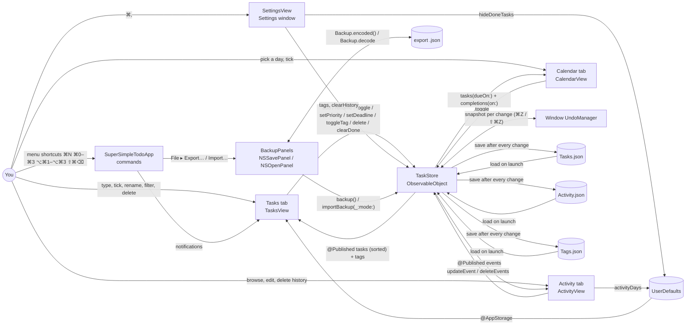

# Super Simple Todo — System Design

A friendly single-window Mac checklist: one list, sorted by priority, with optional tags (Daily, Fitness, Work, Study, plus any you create) and deadlines on each task. You add tasks, tick them off, and clear the finished ones. A Calendar tab shows deadlines by month, and an Activity tab charts what you've done over time.

## Architecture



## Components

| Component | File | Job |
|---|---|---|
| `SuperSimpleTodoApp` | `Super Simple Todo/SuperSimpleTodoApp.swift` | App entry point. Owns the one `TaskStore`, declares the main window, the Settings scene (⌘,) and the menu commands: File ▸ New Task (⌘N), Export… and Import…, View ▸ Tasks/Calendar/Activity (⌥⌘1/⌥⌘2/⌥⌘3), Tasks ▸ Priority (⌘0–⌘3, for the selected tasks) and Clear Done (⇧⌘⌫). The commands reach the views through notifications. |
| `ContentView` | `Super Simple Todo/ContentView.swift` | The "Tasks \| Calendar \| Activity" tab switcher. It hands the window's `UndoManager` to the store. |
| `TasksView`, `GreetingHeader`, `ProgressRing`, `AddTaskField`, `TaskRow`, `DeadlineLabel`, `DeadlinePicker`, `TagChips`, `PriorityKey`, `EmptyState` | `Super Simple Todo/ContentView.swift` | The list screen: a time-of-day greeting with a friendly progress line and a ring; a rounded add field; a quiet color key; `#` tag suggestions under the add field (`TagSuggestions`); an optional "Showing [tag ×]" bar with a removable `FilterToken`; and selectable card rows (colored tick circle that springs into a check, title or rename field, deadline label, clickable tags). Kind empty states cover a new list, all done, and an empty filter. A brief "All done — nice work!" appears when the last task is ticked. Right-click ▸ Deadline offers Today, Tomorrow, In a Week, Pick a Date… (a calendar sheet) and Remove. Keys: ⌫ deletes, Space ticks, Return renames (or goes to the add field with nothing selected), ↑↓ move (↓ from the add field enters the list, ↑ from the top leaves it). The selection follows the list: when the selected tasks are deleted or hidden, the next task is selected (`ListNavigation` in `KeyboardControl.swift`). Each card is one VoiceOver element: title, then done state, priority, tags, deadline and link, with tick, rename, next-step and tag actions. Right-click works on one task (Rename, Priority ▸, Tags ▸, Delete) or several (Tick or Untick, Delete). Double-click renames. Footer: "N of M done", Clear Done, Settings gear. |
| `TagFilter`, `TagAutocomplete` | `Super Simple Todo/TagFilter.swift` | The list's tag filter (toggle, clear, forget a deleted tag, apply with Hide done) and the add field's autocomplete: finding the `#word` being typed, counting each tag's uses, ranking (most used first, then tag order), matching (name starts first, then a later word) and replacing the `#word` with the chosen tag. No SwiftUI, so it is unit-tested directly. |
| `CalendarView`, `MonthGrid`, `DayCell` | `Super Simple Todo/CalendarView.swift` | Month header with Today and ‹ › (or a sideways swipe). A 7-column grid starting on the system's first weekday; each day shows up to three dots in the due tasks' priority colors (grey when done) and a green check if something was finished. Clicking a day lists its due tasks (tickable) and its completions from the activity log. |
| `Theme` | `Super Simple Todo/Theme.swift` | The warm background, card and hairline colors, each with its own light and dark shade. |
| `ActivityView`, `EventRow`, `EventEditor`, `ActivityLegend` | `Super Simple Todo/ActivityView.swift` | A "Completed today · this week" line, a stacked bar chart of actions per day (7, 14 or 30 days), a legend, a hover tooltip per day, and a selectable timeline of every action, newest first, under plain day-header rows. ⌫ deletes selected entries; right-click or double-click opens `EventEditor` (task title, action, new priority, date and time, tags). |
| `SettingsView` | `Super Simple Todo/SettingsView.swift` | All preferences in one place: **Hide done tasks**, the **Tags** list (add, rename, delete, drag to reorder) and **History** (entry count, Clear History… with a confirmation). |
| `TaskStore` | `Super Simple Todo/TaskStore.swift` | The only place tasks, tags and history change. Every change runs through `change(_:_:)`, which snapshots the state, applies the change, registers an undo step and saves. It also parses `#tag` and `!` markers, sorts and filters, and records one event per action. |
| `Backup`, `BackupError`, `ImportMode`, `ImportSummary` | `Super Simple Todo/Backup.swift` | The export file: its format name and version, encoding (dates with milliseconds) and checked decoding, which refuses invalid JSON, other JSON, files from a newer version and damaged files with a message naming the problem (e.g. "tasks[0].title is missing."). No AppKit, so it is unit-tested directly. |
| `BackupPanels` | `Super Simple Todo/BackupPanels.swift` | File ▸ Export… (an `NSSavePanel`, default name "Super Simple Todo <date>.json") and File ▸ Import… (an `NSOpenPanel` for JSON, then a Merge / Replace / Cancel alert, then a summary of what was added and skipped). Errors appear as alerts and import nothing. |
| `TaskItem`, `Priority` | `Super Simple Todo/TaskItem.swift` | One task (id, title, done flag, priority, tags, created date) and the four priority levels. Files from the sections version are upgraded by `TaskStore` (see **Upgrading from sections**). |
| App icon | `Super Simple Todo/Assets.xcassets/AppIcon.appiconset`, drawn by `tools/MakeIcon.swift` | A white checklist tile with a ticked red task, then orange and blue ones, echoing the priority colors. The script draws the 1024 px master with Core Graphics; the 16–512 pt sizes are scaled from it with `sips`. |
| `ActivityEvent`, `dailyCounts`, `completedCounts` | `Super Simple Todo/ActivityEvent.swift` | One logged action (date, kind, task title, optional detail, tags at the time; all editable except the id), the per-day counts the chart draws, and the today and this-week completion counts. |
| Scripts | `tools/install.sh`, `tools/screenshots.sh` | `install.sh` builds a Release copy and puts it in /Applications. `screenshots.sh` retakes the README images from a separate test copy (its own app ID) running on generated sample data. |

## Tags

- **Starting tags:** Daily, Fitness, Work, Study, offered in the right-click menu. They're created the first time the app runs without a `Tags.json`. When upgrading from the sections version, the old section names are used instead.
- **Tagging while typing:** add one or more `#name` words anywhere, e.g. `Run 5k #fitness #daily !!`. A tag matches an existing one ignoring case. An unknown tag is created on the spot: `#deep-work` becomes "Deep work". A tag must start with a letter, so "#1" and "C#" stay part of the title.
- **Tagging later:** right-click ▸ Tags ▸ tick or untick any tag, or choose **New Tag…** to type a new one. Renaming a task and typing `#name` also adds that tag.
- **Suggestions:** typing `#` in the add field opens a small list of known tags under it, most used first (with each tag's task count), narrowed as you type. ↑↓ pick, Tab or Return accepts (it types `#deep-work ` for "Deep work"), Esc closes it, and clicking a row accepts it. Return adds the task as usual once the tag is typed in full. It reads the `#word` at the end of the text, since a SwiftUI text field doesn't expose the cursor.
- **Filtering:** click any tag chip on a task to show only tasks with that tag. A "Showing [tag ×]" token appears above the list; click its ×, click the same tag again, or press Esc (in the list or the add field) to show everything. The filter clears itself if that tag is deleted.
- **Managing tags:** Settings (⌘,) ▸ Tags lets you add, rename (every task updates), delete (removed from every task) and drag to reorder.
- **The list:** one flat list (open tasks first, then by priority), with no grouping. Each task shows its tags as small grey labels after the title.
- **Activity:** each timeline row shows the task's tags at the time of the action.

## Deadlines

- **What a deadline is:** a calendar day (no time) on a task, or none. Any time on that day counts as the day.
- **Setting one:** type `@today`, `@tomorrow`, `@fri`, `@oct30`, `@30oct`, `@10/30` or `@2026-10-30` while adding or renaming a task, or use right-click ▸ Deadline. A weekday means the next one, today included. A month and day that have already passed this year mean next year. Impossible dates like `@feb30`, and other `@` words like email addresses, stay in the title.
- **In the list:** a small label reads "Today", "Tomorrow", a weekday within the next week, or a short date. Open tasks past their day show a red "Overdue". Deadlines don't change the sort.
- **Calendar:** dots per day, and the selected day's due and finished tasks.
- **Not logged in Activity:** setting or clearing a deadline isn't one of the five recorded actions, so the chart's colors stay the same.

## Next steps

- **A task's link:** a task can carry one web address. It comes from typing or pasting `https://…` or `www.…` into a task (the first address is taken out of the title), or from right-click ▸ Add Link… / Edit Link… (where a bare `site.com/page` also works). It shows under the title as "↗ Open site.com" and is saved as the `link` field.
- **Ask Claude:** tasks without a link, while open, show "✦ Ask Claude how to start" under the title once the pointer has rested on them for about half a second, or while they're selected. The delay stops rows flickering as the pointer sweeps past. The link carries a short prompt: the task's title, its deadline if any, and a request for the first concrete step. When the Claude desktop app is installed (it registers `claude://`), the link is `claude://claude.ai/new?q=…`, which the app opens as a new chat with the prompt in the message box. Otherwise it's `https://claude.ai/new?q=…` in the browser. Nothing leaves the Mac until it's clicked, and the message isn't sent until you press send there.
- **Kept simple on purpose:** no API key, no network calls from the app, no AI-written suggestions stored in the list.

## Look and feel

- **Warm and soft:** a faint warm background (warm near-black in dark mode), white rounded cards with a hairline border, and a rounded add field with a plus icon. Selected cards take a light accent tint.
- **Friendly words:** a greeting by time of day ("Good morning", up to "Hello, night owl"), a progress line ("2 of 8 done. Nice going."), and kind empty states.
- **Motion:** the tick circle springs into a check, rows ease into place, the progress ring animates, and a small "All done" message appears briefly when the last task is ticked. With Reduce Motion turned on in System Settings, these changes happen without animation.
- **Priority colors stay as they were;** the warm accents (sun icon, empty-state symbols) use orange sparingly.

## Priorities and colors

| Circle color | Priority | How to set it |
|---|---|---|
| Red | High | End a new task with ` !!!`, or right-click ▸ Priority ▸ High |
| Orange | Medium | ` !!` or right-click |
| Blue | Low | ` !` or right-click |
| Grey | None | The default; right-click ▸ Priority ▸ None |

The exclamation marks must be a separate word, so "Wow!" stays a plain task. Typing only markers (e.g. "!!!") keeps the text as the title. The list puts open tasks first and done ones at the bottom. Within each group it sorts High → None, then by the order tasks were added. The key under the input field spells out the colors, and hovering a circle names its priority. VoiceOver reads the priority too, so color is never the only cue.

The Activity chart uses a separate, validated palette, one color per action: Added (blue), Completed (orange), Deleted (aqua), Unticked (yellow), Priority changed (pink). It was checked for color-blind separation in light and dark mode. Each color has its own light and dark shade. Its own legend and the text timeline carry the labels, because three of the light-mode colors are low-contrast against the background.

## Main flows

- **Add:** type in "Add a task" and press Return. `TaskStore.add` flattens line breaks, trims spaces, reads any `!`/`!!`/`!!!` word as a priority and every `#name` as a tag (creating new ones), ignores blanks, and logs **Added**.
- **Tick / untick:** click the circle, or select rows and press Space. This logs **Completed** or **Unticked**. Done tasks are struck through and move to the bottom. With several selected, if any is open they all become done; otherwise they all reopen.
- **Rename:** double-click, press Return on a selected row, or right-click ▸ Rename. Return saves and Esc cancels. `#name` words add tags, and `!` markers change the priority (logged as **Priority**). A plain rename isn't logged.
- **Change priority:** right-click ▸ Priority. Logs **Priority** with the new level (choosing the current level logs nothing).
- **Delete:** select one or more rows and press ⌫, or right-click ▸ Delete. Logs **Deleted** per task.
- **Clear Done:** the button or ⇧⌘⌫ removes every finished task, logging one **Deleted** per task.
- **Undo / redo:** ⌘Z and ⇧⌘Z in the main window undo any change above, plus tag and history changes. The Edit menu names the step, e.g. "Undo Clear Done".
- **Activity tab:** `dailyCounts` buckets events by local calendar day for the chosen range, and `completedCounts` gives the summary line (the week starts on your system's first weekday). Hovering a bar shows that day's counts. The timeline below lists every event.
- **Editing history:** select timeline entries and press ⌫ to delete them, or right-click or double-click one to edit it. Settings ▸ History ▸ Clear History… deletes the whole log. History edits never touch tasks, and new tags typed in an entry are added to the tag list.
- **Hide done tasks:** a Settings toggle. It only filters the view.
- **Export:** File ▸ Export… writes `TaskStore.backup()` (tasks, tags, history) to the chosen file. Nothing in the store changes.
- **Import:** File ▸ Import… reads the chosen file with `Backup.decode`; any error stops here with an alert. Then it asks **Merge** or **Replace**. `TaskStore.importBackup` applies it as one undo step ("Undo Import") and saves:
  - **Replace** swaps all tasks, tags and history for the file's, in the file's order.
  - **Merge** keeps everything here. A task or history entry whose `id` is already here is skipped, so your version wins and importing the same file twice adds nothing. New tasks go after the current ones, history is re-sorted by date, and the file's tags are added after yours, matched ignoring case (a task's `fitness` becomes your `Fitness`).
- **Launch:** `TaskStore` reads both files. If `Activity.json` doesn't exist yet, it fills in one **Added** event per task from its saved creation date. That's the only history available from before tracking started.

## Upgrading from sections

The sections version (2026-10-11) saved an optional `"section"` on each task and logged action, and the section names, in order, in `Sections.json`. On the first launch after upgrading, `TaskStore.migrateSections` turns that into tags once:
- Each task's section becomes one tag of the same name, matched to the known tags ignoring case and spaces; a task in "Other" (no section) or with a blank section gets no tag. Task order is unchanged.
- `Sections.json`'s names, in order, become the tag list (empty sections included, the starter tags not added).
- Each logged action's section becomes its tag, even for a section deleted since; such a name isn't added to the tag list.
- The result is saved straight away, so `Tasks.json` and `Activity.json` no longer contain `section` and a `Tags.json` exists. `Sections.json` is renamed `Sections.migrated.json` (kept, not deleted; dated if that name is already taken), and the old `collapsedSections` preference is removed.
- Later launches find nothing to migrate and don't rewrite the files.

## Where data lives

- Tasks: `~/Library/Application Support/Super Simple Todo/Tasks.json`
- Activity log: `~/Library/Application Support/Super Simple Todo/Activity.json`
- Known tags and their order: `~/Library/Application Support/Super Simple Todo/Tags.json` (a `Sections.json` from the sections version is migrated once and then kept as `Sections.migrated.json`)
- All three are pretty-printed JSON with ISO 8601 dates, written atomically. A file that exists but can't be read is renamed to `<name>.unreadable-<date>.json` before the app starts fresh, so the next save can't overwrite it.
- Preferences: UserDefaults for `com.amalmehta.SuperSimpleTodo`: `hideDoneTasks`, `activityDays`.
- Sample data for trying the app: launch with `--args -TasksFile /path/Tasks.json`. `Activity.json` and `Tags.json` are then read from the same folder, and your real data is never touched. Add `-StartTab activity` to open on the Activity tab. Both options were used for the README screenshots.
- Nothing leaves the Mac. No network, no accounts, no sync.

## Export file format

File ▸ Export… writes one pretty-printed UTF-8 JSON object with sorted keys:

```json
{
  "activity" : [
    { "date" : "2026-10-21T08:30:00.250Z", "id" : "7F96…", "kind" : "completed",
      "tags" : [ "Work" ], "taskTitle" : "Write report" }
  ],
  "exportedAt" : "2026-10-21T09:00:00.000Z",
  "format" : "super-simple-todo",
  "tags" : [ "Daily", "Fitness", "Work", "Study" ],
  "tasks" : [
    { "createdAt" : "2026-10-20T08:00:00.000Z", "deadline" : "2026-10-24", "id" : "6F96…", "isDone" : true,
      "link" : "https://example.com", "priority" : 2, "tags" : [ "Work" ], "title" : "Write report" }
  ],
  "version" : 1
}
```

| Key | Meaning |
|---|---|
| `format` | Always `"super-simple-todo"`. Anything else (including a bare `Tasks.json` array) is refused as "isn't a Super Simple Todo export". |
| `version` | The format version, a whole number. This build writes and reads `1` (`Backup.currentVersion`). A higher number is refused as "exported by a newer version", before the rest of the file is read, so a future format can change anything else. |
| `exportedAt` | When the file was written. Informational; import ignores it. |
| `tags` | Known tag names in display order, the same as `Tags.json`. |
| `tasks` | Tasks in the order added, each as in `Tasks.json`: `id` (UUID), `title`, `isDone`, `priority` (0 none, 1 low, 2 medium, 3 high), `tags`, `deadline` (a plain `yyyy-MM-dd` day, omitted when unset), `link` (omitted when unset) and `createdAt`. IDs must be unique. |
| `activity` | The Activity tab's history, as in `Activity.json`: `id`, `date`, `kind` (`added`, `completed`, `deleted`, `uncompleted`, `priorityChanged`), `taskTitle`, `detail` (the new priority's name, for `priorityChanged`) and `tags` at the time. IDs must be unique. |

- **Completion timestamps** are the `date` of `completed` entries in `activity`; a task itself only stores `isDone`. This is what the Activity chart, the "Completed today · this week" line and the calendar's finished list are drawn from.
- **Dates** are ISO 8601 in UTC with milliseconds. Import also accepts them without milliseconds, so a hand-written file works. The app's own files keep dates to the second, so an export of a relaunched app round-trips exactly.
- **Damaged files** (invalid JSON, a missing or non-numeric `version`, a missing or wrongly typed field, an unknown `kind` or `priority`, a bad date, a repeated ID) are refused with an alert naming the first problem, such as "tasks[0].title is missing." Nothing is imported.
- **Changing the format:** raise `Backup.currentVersion`, keep reading every older version (convert it on import), and note the change here.

## Key decisions and trade-offs

- **SwiftUI with JSON files instead of SwiftData or Core Data.** The data is small, the files are readable, and backup is easy. The cost is rewriting both files on every change, which is fine at this size.
- **An event log, separate from the tasks.** Deleted tasks still appear in history, and the chart is just a count over events. The log grows forever (see limits).
- **Tags instead of sections (changed 2026-10-21).** The owner wanted one list rather than separate groups. A task can carry any number of tags, so nothing has to be filed in exactly one place. The trade-off is that you can't collapse or hide a group; filtering by tag covers most of that.
- **Sections are migrated once, in one place.** `TaskItem` and `ActivityEvent` know nothing about sections; `TaskStore.migrateSections` reads the old keys, converts them and saves, so the old format is gone after one launch. The old `Sections.json` is renamed rather than deleted, in case anything needs recovering.
- **Tags are stored on each task by name, not by id.** The files stay readable, and there's no lookup table. A rename has to update every task, which `renameTag` does. Names are unique, ignoring case.
- **A separate list of known tags,** so the right-click menu can offer tags no task uses yet. Tag management lives in Settings with the other preferences.
- **Events store the task's title, not a link to the task.** History stays readable after a task is deleted. Renaming a task doesn't rewrite old events; they keep the title it had at the time.
- **Next steps are a link, not generated text.** A prefilled claude.ai chat gives guidance without an API key, costs or background network use. The trade-off is that the app can't judge which tasks most need a nudge, so Ask Claude appears on hover or selection rather than always.
- **Deadlines are days, saved as "yyyy-MM-dd".** Storing a date-time would shift a deadline to another day if you changed time zones. A plain date can't. Times weren't needed.
- **Deadlines don't reorder the list.** The list stays priority-first so tasks don't jump around as days pass; the label and the red "Overdue" do the signalling.
- **Undo by snapshots.** Before each change the store copies its three arrays; undo swaps them back and registers the reverse for redo. One generic mechanism covers every action, with no per-action undo code. Copying is cheap at this size. Undo lives in the main window's `UndoManager`, so ⌘Z in the Settings window doesn't undo tag changes; ⌘Z in the main window does.
- **History is editable.** The log is a personal record, not an audit trail, so you can fix, delete or clear entries. Edits are undoable and never change tasks.
- **Day headers in the timeline are plain rows.** macOS pins `List` section headers while scrolling, and a pinned header could cover the row beneath it so a day looked empty.
- **Priority is a sort plus a color, not manual ordering.** There's nothing to drag. The trade-off is that you can't hand-order tasks within a level.
- **Swift Charts** (macOS 14's `chartXSelection` for hover). No dependencies.
- **Old files still load.** Tasks without a `priority` key load as None, and a missing `Activity.json` is filled in from creation dates.
- **Save on every change, written atomically.** There's no unsaved state, and a crash can't leave a half-written file.
- **The store takes a file URL.** Tests use temporary files, and `-TasksFile` points the app at sample data.
- **The icon is drawn in code, not a design file.** It can be regenerated and diffed, needs no design app, and stays in step with the priority colors. The trade-off is that tweaking it means editing the script. It uses the classic rounded-square asset catalog icon rather than a macOS 26 Icon Composer (`.icon`) file, so it doesn't pick up the new glass and tinted styles.
- **XcodeGen (`project.yml`) generates the Xcode project.** Run `xcodegen generate` after adding a file. The generated `.xcodeproj` is committed.
- **Export is one versioned file, separate from the live files.** One file is easier to move and email than three, and the `format`/`version` header lets the app refuse what it can't read instead of guessing. Merge dedupes by ID and keeps the local copy, so local edits are never overwritten by an older export; use Replace to restore a backup exactly.
- **No feedback tab.** Left out at the owner's request (2026-10-06).

## Testing

`Tests/TaskStoreTests.swift` has 38 XCTest unit tests:
- Adding: trims spaces, ignores blanks, flattens line breaks, and turns a trailing `!`/`!!`/`!!!` into a priority.
- Tick/untick and the done count; delete and Clear Done.
- Priority sorting, done tasks sinking below open ones, filtering by tag and hiding done tasks.
- Rename (keeps tags, reads `#tag` and `!`, ignores blank and unchanged text), and ticking or deleting several tasks at once.
- Undo and redo across add, tick and Clear Done, including the saved file.
- History: editing an entry (title, action, date, tags), deleting entries, and clearing the log, all without touching tasks; today and this-week completion counts.
- Saving and reloading across launches; old files without priorities; a corrupt file is kept as an `.unreadable-` backup instead of being overwritten.
- Deadlines: `parseDay` (today, tomorrow, weekdays including today, month and day in both orders, m/d, ISO, rolling to next year, and rejecting "sunny", "feb30" and plain numbers) against a fixed Wednesday; `@day` in typed text alongside `#` and `!` while email addresses stay; setting, clearing, undoing and renaming with `@day`; saving as a plain date with no key when unset; the calendar's per-day due and finished lists; and the label text.
- Next steps: links pulled from typed text (`https://`, `www.`, trailing punctuation) while email addresses and bare domains stay in the title; Add, Edit and Remove Link with undo, saving, and rejecting non-addresses; links set by rename; the "Open site" label; and the Ask Claude URL (`claude://` for the app, `https://` otherwise, path /new with a `q` prompt that keeps `&` and includes the deadline).
- Every action is logged and saved; history is filled in from creation dates; daily counts group by day and drop days outside the range.
- Tag filter and suggestions (`Tests/TagFilterTests.swift`, 8 tests): the `#word` being typed (including just `#` and `#deep-wo`, but not after a space, inside "C#" or "#1"); typed and accepted tags parsing back to the same name; use counts and ranking with ties in tag order; matching ignoring case, name starts before later words, `-` as a space, and the limit; accepting a suggestion; and the filter's toggle, switch, clear, forgetting a deleted tag, and applying it with Hide done.
- Export and import (`Tests/BackupTests.swift`, 11 tests): a store with tags (one unused, one renamed), priorities, a deadline, a link, completions on two days, a priority change, a deletion and an edited history entry is exported and imported into an empty store, and the two are equal: tasks, tags, history and the Activity tab's numbers (daily counts, today and this week, each day's completions), also after reopening; merging into an empty store keeps the starter tags first; exporting the imported store gives the same bytes; merging skips tasks and history already present by ID and keeps local edits; tags match ignoring case; import is one undo step; the file's keys, version, date and deadline formats; hand-written whole-second dates; and the errors for invalid JSON, a missing or string `version`, a missing field, a bad date, repeated IDs, other JSON, and a newer version.
- Keyboard (`Tests/KeyboardControlTests.swift`, 16 tests): ↑/↓ with nothing, one or several selected, at both ends and leaving for the add field; the selection kept, or moved to the next or previous task, after deletes, re-sorting and ticking with done hidden; Space on a mixed selection, ⌫, and priority for several tasks, each one undo step; and the VoiceOver text (done state, priority, tags, overdue deadline, link) and spoken key names.
- Tags: a fresh store gets the four starters; `#tag` parsing and on-the-fly creation (several per task, case matching, duplicates dropped, `#deep-work`, "#1" and "C#" ignored, tag-only input); the list stays one priority-sorted list; toggle, rename (refuses a taken name) and delete update tasks; events record tags.
- Upgrading from sections, against files saved by the sections version (`Tests/Fixtures/SectionsVersion`): each section becomes the same tag with task order, priorities and done state kept, "Other" gets no tag, `Sections.json`'s order (empty sections included) becomes the tag order, and logged actions keep their section (even a deleted one) as a tag; the upgrade saves at once without `section`, renames `Sections.json` (dated if an earlier backup has the name), clears `collapsedSections` and reloads identically; case and spaces are matched and blank sections skipped; files already in the tags format aren't rewritten.

Run them with:

```
xcodebuild -project SuperSimpleTodo.xcodeproj -scheme "Super Simple Todo" -derivedDataPath build test
```

Manual checks in the running app:
- 2026-10-06: add, tick, delete, Settings, Hide done tasks, Clear Done, relaunch.
- 2026-10-10, on sample data: color key and circle colors, priority sort, Activity tab at 7, 14 and 30 days, and a tick appearing live in the timeline.
- 2026-10-21, screenshots of a test copy on sample data: the tag labels, priority colors and sorting on the Tasks tab, and the Activity chart and timeline with tags.
- 2026-10-21, `tools/screenshots.sh` on sample data: done tasks at the bottom, the "Completed today · this week" line, and plain day headers in the timeline.
- 2026-10-21, `tools/screenshots.sh`: the new look (greeting, ring, cards), deadline labels including a red Overdue, and the Calendar tab's dots, today marker and day list.
- 2026-10-21, `tools/screenshots.sh`: "↗ Open site" next-step links under tasks.
- Not yet checked by hand: File ▸ Export… and Import… (the panels, the Merge or Replace alert and the error and summary alerts), Ask Claude appearing on hover or selection and opening claude.ai, the Add Link prompt, the tick animation and the "All done" celebration, the deadline picker sheet, month switching and swiping, the keyboard keys in the window (⌫, Space, Return, ↑↓, ⌘0–⌘3, ⌥⌘1–3), VoiceOver reading the cards, renaming in place, tag filtering, the `#` suggestions (Tab and Return in the field, the list floating over the tasks), Esc clearing the filter, the right-click menus, the history editor, Clear History, undo in the app, and the hover tooltip. These need clicking, and screen access was declined. Their store-side logic is covered by the tests above.

## Known limits

- Deadlines are days only: no times, reminders or notifications. No subtasks or manual reordering.
- Filtering is one tag at a time.
- Tag suggestions follow the `#word` at the end of the add field, not one typed in the middle. A tag whose own name has a hyphen ("Follow-up") can't be typed back exactly, since `#follow-up` reads as "Follow up".
- Adding or removing a tag, and plain renames, aren't logged in Activity.
- Undo history lasts until the app quits.
- The activity log is never trimmed. Thousands of events are fine; years of heavy use would make each save slower.
- History from before 2026-10-10 contains only **Added** events.
- Only one copy of the app should run on the same data at a time.
- The app is ad-hoc signed for local use, not notarized.
