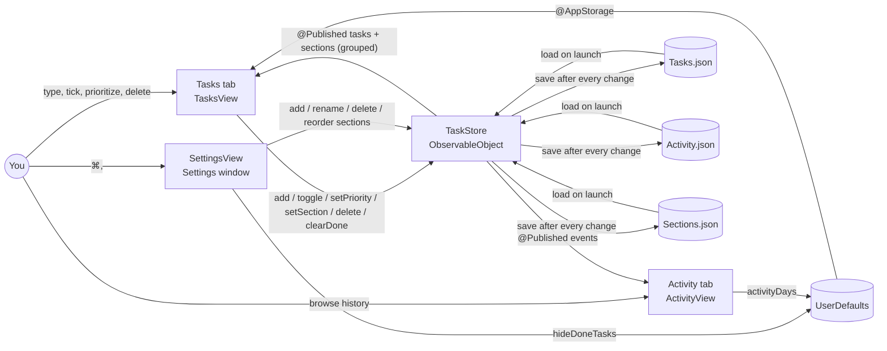

# Super Simple Todo — System Design

A single-window Mac checklist with priorities and sections (Daily, Fitness, Work, Study, plus any you create). You add tasks, tick them off, and clear the finished ones. An Activity tab charts what you've done over time.

## Architecture



## Components

| Component | File | Job |
|---|---|---|
| `SuperSimpleTodoApp` | `Super Simple Todo/SuperSimpleTodoApp.swift` | App entry point. Owns the one `TaskStore`, declares the main window and the Settings scene (⌘,). |
| `ContentView` | `Super Simple Todo/ContentView.swift` | The "Tasks \| Activity" tab switcher at the top of the window. |
| `TasksView`, `SectionHeader`, `TaskRow`, `PriorityKey` | `Super Simple Todo/ContentView.swift` | The list: input field, a one-line color key, collapsible section headers with an open-task count, rows with a colored tick circle, a right-click menu (Priority ▸, Section ▸, Delete), and a footer with "N of M done", Clear Done and a Settings gear. |
| `ActivityView`, `EventRow`, `ActivityLegend` | `Super Simple Todo/ActivityView.swift` | A stacked bar chart of actions per day (7, 14 or 30 days), a legend, a hover tooltip per day, and a timeline of every action, newest first, grouped by day. |
| `SettingsView` | `Super Simple Todo/SettingsView.swift` | All preferences in one place: **Hide done tasks**, and the **Sections** list (add, rename, delete, drag to reorder). |
| `TaskStore` | `Super Simple Todo/TaskStore.swift` | The only place tasks and sections change. Holds the tasks, sections and activity log in memory, parses `#section` and `!` markers, groups and sorts, records one event per action, and writes all three files after every change. |
| `TaskItem`, `Priority` | `Super Simple Todo/TaskItem.swift` | One task (id, title, done flag, priority, section, created date) and the four priority levels. |
| App icon | `Super Simple Todo/Assets.xcassets/AppIcon.appiconset`, drawn by `tools/MakeIcon.swift` | A white checklist tile with a ticked red task, then orange and blue ones, echoing the priority colors. The script draws the 1024 px master with Core Graphics; the 16–512 pt sizes are scaled from it with `sips`. |
| `ActivityEvent`, `dailyCounts` | `Super Simple Todo/ActivityEvent.swift` | One logged action (date, kind, task title, optional detail, section at the time), and the per-day counts the chart draws. |

## Sections

- **Starting sections:** Daily, Fitness, Work, Study. They're created the first time the app runs without a `Sections.json`.
- **Filing a task while typing:** add `#name` anywhere in it, e.g. `Run 5k #fitness !!`. The tag matches an existing section ignoring case. An unknown tag creates a section on the spot: `#deep-work` becomes "Deep work". The tag must start with a letter, so "#1" and "C#" stay part of the title. If you type two tags, the first one wins.
- **Moving a task later:** right-click ▸ Section ▸ any section, or Other.
- **Managing sections:** Settings (⌘,) ▸ Sections lets you add, rename (tasks follow), delete (tasks move to Other) and drag to reorder.
- **The list:** one header per section in Settings order, then **Other** for unfiled tasks. Each header shows how many open tasks it has and collapses with a click; collapsed sections are remembered. Every section always shows, even when empty; an empty one shows a hint such as "Add one with #fitness". "Other" appears only when there are unfiled tasks. Within a section, tasks sort by priority.
- **Activity:** each timeline row shows the task's section at the time of the action as a small grey label.

## Priorities and colors

| Circle color | Priority | How to set it |
|---|---|---|
| Red | High | End a new task with ` !!!`, or right-click ▸ Priority ▸ High |
| Orange | Medium | ` !!` or right-click |
| Blue | Low | ` !` or right-click |
| Grey | None | The default; right-click ▸ Priority ▸ None |

The exclamation marks must be a separate word, so "Wow!" stays a plain task. Typing only markers (e.g. "!!!") keeps the text as the title. The list sorts High → None, and within a level keeps the order tasks were added. The key under the input field spells out the colors, and hovering a circle names its priority. VoiceOver reads the priority too, so color is never the only cue.

The Activity chart uses a separate, validated palette, one color per action: Added (blue), Completed (orange), Deleted (aqua), Unticked (yellow), Priority changed (pink). It was checked for color-blind separation in light and dark mode. Each color has its own light and dark shade. Its own legend and the text timeline carry the labels, because three of the light-mode colors are low-contrast against the background.

## Main flows

- **Add:** type in "Add a task" and press Return. `TaskStore.add` flattens line breaks, trims spaces, reads any `!`/`!!`/`!!!` word as a priority and the first `#name` as a section (creating it if needed), ignores blanks, and logs **Added**.
- **Tick / untick:** click the circle. This logs **Completed** or **Unticked**. Done tasks are struck through.
- **Change priority:** right-click ▸ Priority. Logs **Priority** with the new level (choosing the current level logs nothing).
- **Delete one:** right-click ▸ Delete (or ⌫ on a selected row). Logs **Deleted**.
- **Clear Done:** removes every finished task, logging one **Deleted** per task.
- **Activity tab:** `dailyCounts` buckets events by local calendar day for the chosen range. Hovering a bar shows that day's counts. The timeline below lists every event.
- **Hide done tasks:** a Settings toggle. It only filters the view.
- **Launch:** `TaskStore` reads both files. If `Activity.json` doesn't exist yet, it fills in one **Added** event per task from its saved creation date. That's the only history available from before tracking started.

## Where data lives

- Tasks: `~/Library/Application Support/Super Simple Todo/Tasks.json`
- Activity log: `~/Library/Application Support/Super Simple Todo/Activity.json`
- Sections and their order: `~/Library/Application Support/Super Simple Todo/Sections.json`
- Both are pretty-printed JSON with ISO 8601 dates, written atomically.
- Preferences: UserDefaults for `com.amalmehta.SuperSimpleTodo`: `hideDoneTasks`, `activityDays`, `collapsedSections`.
- Sample data for trying the app: launch with `--args -TasksFile /path/Tasks.json`. `Activity.json` and `Sections.json` are then read from the same folder, and your real data is never touched.
- Nothing leaves the Mac. No network, no accounts, no sync.

## Key decisions and trade-offs

- **SwiftUI with JSON files instead of SwiftData or Core Data.** The data is small, the files are readable, and backup is easy. The cost is rewriting both files on every change, which is fine at this size.
- **An event log, separate from the tasks.** Deleted tasks still appear in history, and the chart is just a count over events. The log grows forever (see limits).
- **Tasks store their section by name, not by id.** The files stay readable, and there's no lookup table. A rename has to update every task in that section, which `renameSection` does. Names are unique, ignoring case.
- **One task, one section.** This keeps the grouped list simple: no task appears twice. Tags that put a task in several groups would need a different layout.
- **Sections management lives in Settings,** with the other preferences. `#tag` and right-click handle everyday filing.
- **Events store the task's title, not a link to the task.** History stays readable after a task is deleted. If a title were later edited, old events would keep the old title.
- **Priority is a sort plus a color, not manual ordering.** There's nothing to drag. The trade-off is that you can't hand-order tasks within a level.
- **Swift Charts** (macOS 14's `chartXSelection` for hover). No dependencies.
- **Old files still load.** Tasks without a `priority` key load as None, and a missing `Activity.json` is filled in from creation dates.
- **Save on every change, written atomically.** There's no unsaved state, and a crash can't leave a half-written file.
- **The store takes a file URL.** Tests use temporary files, and `-TasksFile` points the app at sample data.
- **The icon is drawn in code, not a design file.** It can be regenerated and diffed, needs no design app, and stays in step with the priority colors. The trade-off is that tweaking it means editing the script. It uses the classic rounded-square asset catalog icon rather than a macOS 26 Icon Composer (`.icon`) file, so it doesn't pick up the new glass and tinted styles.
- **XcodeGen (`project.yml`) generates the Xcode project.** Run `xcodegen generate` after adding a file. The generated `.xcodeproj` is committed.
- **No feedback tab.** Left out at the owner's request (2026-10-06).

## Testing

`Tests/TaskStoreTests.swift` has 17 XCTest unit tests:
- Adding: trims spaces, ignores blanks, flattens line breaks, and turns a trailing `!`/`!!`/`!!!` into a priority.
- Tick/untick and the done count; delete and Clear Done.
- Priority sorting.
- Saving and reloading across launches; old files without priorities; a corrupt file.
- Every action is logged and saved; history is filled in from creation dates; daily counts group by day and drop days outside the range.
- Sections: a fresh store gets the four starters; `#tag` filing and on-the-fly creation (case matching, `#deep-work`, "#1" and "C#" ignored, tag-only input); grouping follows section order then Other; rename refuses a taken name and updates tasks; delete moves tasks to Other; events record the section.

Run them with:

```
xcodebuild -project SuperSimpleTodo.xcodeproj -scheme "Super Simple Todo" -derivedDataPath build test
```

Manual checks in the running app:
- 2026-10-06: add, tick, delete, Settings, Hide done tasks, Clear Done, relaunch.
- 2026-10-10, on sample data: color key and circle colors, priority sort, Activity tab at 7, 14 and 30 days, and a tick appearing live in the timeline.
- Not yet checked by hand: the hover tooltip and the right-click Priority menu (both need full screen control, which wasn't available), and the sections UI. Screen access was declined on 2026-10-11, so section headers, collapsing, right-click ▸ Section and the Settings Sections list have only been built and unit-tested on the store side.

## Known limits

- No due dates, manual reordering within a section, title editing or undo.
- A task belongs to one section at most.
- Moving a task to another section isn't logged in Activity.
- The activity log is never trimmed. Thousands of events are fine; years of heavy use would make each save slower.
- History from before 2026-10-10 contains only **Added** events.
- If `Tasks.json` is corrupt, the app starts empty, and the next change overwrites it. There's no backup.
- Only one copy of the app should run on the same data at a time.
- The app is ad-hoc signed for local use, not notarized.
